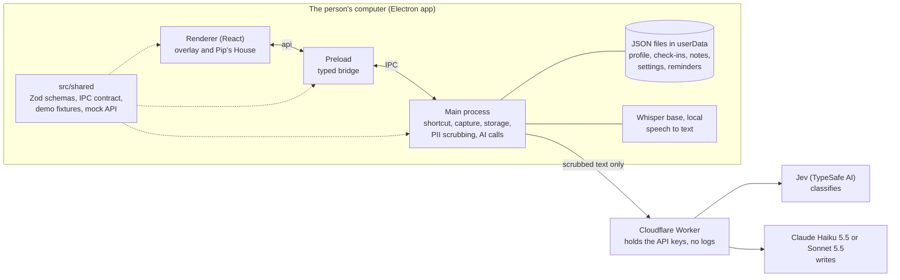
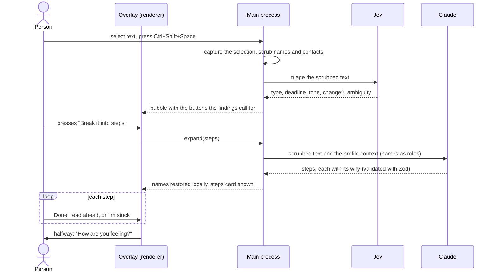
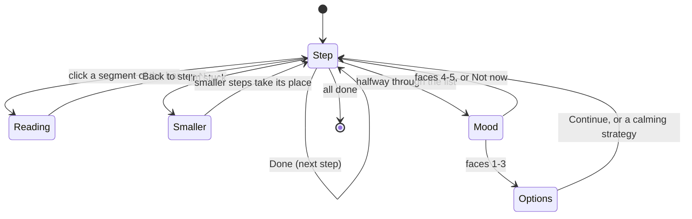
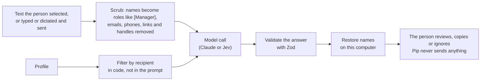

# Pip

**A desktop companion for autistic adults in their first year of work.** Pip keeps a person's professional profile alive and uses it, in the moment, to turn vague work messages into small, clear steps, especially when something at work changes.

<p align="center">
  
</p>

> **Status:** working prototype built for the NA AI Challenge 2026 (Arizona State University) with Specialisterne as Challenge Partner. It is built for Windows, macOS and Linux; the live-demo target is an Apple Silicon Mac. Without a team access token Pip answers from built-in demo data, so anyone can run it. See [Known limitations](#known-limitations) for what is still untested.

## Contents

1. [Why Pip exists](#why-pip-exists)
2. [What Pip does](#what-pip-does)
3. [How to use it](#how-to-use-it)
4. [How it works](#how-it-works) (architecture, request flow, privacy, AI roles)
5. [Getting started](#getting-started) (requirements, install, configuration, running, packaging)
6. [Project structure](#project-structure)
7. [Testing and evaluation](#testing-and-evaluation)
8. [Documentation map](#documentation-map)
9. [Credits, external resources and AI assistance](#credits-external-resources-and-ai-assistance)
10. [Team and workflow](#team-and-workflow)
11. [Known limitations](#known-limitations)
12. [License](#license)

| Looking for | Go to |
|---|---|
| What the project is and who it is for | [Why Pip exists](#why-pip-exists) |
| What each feature does and how to use it | [What Pip does](#what-pip-does), [How to use it](#how-to-use-it) |
| Install steps, requirements, environment variables | [Getting started](#getting-started) |
| Which AI models are used, and what data leaves the computer | [How it works](#how-it-works) |
| Third-party code, models, fonts and AI assistance | [Credits, external resources and AI assistance](#credits-external-resources-and-ai-assistance) |

## Why Pip exists

Getting a job is not the hardest part for many autistic adults; keeping it is. Our interview with a Specialisterne coach (October 31, 2026) showed where it breaks:

- **Vague instructions.** "Send it when you get a chance" hides a date, a priority and an expectation. Written, specific instructions work best, but managers do not always give them.
- **Unwritten rules.** Meetings, lunch and tone come with norms nobody says out loud.
- **Changes.** A new manager, a new project or new priorities destabilize a person who was doing well, and the support that came with coaching fades after the first months.
- **A profile that goes stale.** Specialisterne writes a professional profile for each person (how they learn, what stresses them, what adjustments they need). It is exactly what an assistant could use every day, but today it sits in a document.

Pip is that assistant. It lives on top of the apps the person already uses, reads only what they select, and answers with a short explanation, small steps and, every time, **why**.

**What Pip is not.** It is not a focus timer, a to-do list or a chatbot. It never reads email or chat by itself, never sends anything for the person, and never scolds. The research behind these choices is in [docs/research/](docs/research/) and the reasoning in [docs/DECISIONS.md](docs/DECISIONS.md).

**Design principles**

| Principle | What it means in the product |
|---|---|
| Privacy is the product | Only text the person selects (or types or dictates and sends) leaves the computer, and only after names and contact details are removed |
| Every suggestion carries its why | Steps, questions and notes explain themselves, so the person keeps learning the rules instead of feeling they "express themselves badly" |
| Ask, don't guess | When a date or a request is unclear, Pip drafts the question instead of inventing an answer |
| Calm by default | No red or yellow, no streaks, no alarms; everything is skippable; motion respects `prefers-reduced-motion` |
| The person decides | Pip suggests; the person accepts, edits, copies or ignores |

## What Pip does

### One shortcut, a bubble next to the cursor

Select text anywhere and press **Ctrl+Shift+Space** (Control+Shift+Space on a Mac). Pip appears next to the cursor with what matters at a glance: the date (and whether it was stated or inferred), whether a reply is needed, the tone with the phrase that shows it, and whether the message announces a change. The buttons it offers come from those findings.

<p align="center">
  
</p>

### Steps, one at a time

"Break it into steps" opens a card with one step at a time, each with its reason and the part of the person's profile Pip used ("Used your manual").

<table>
  <tr>
    <td width="50%"></td>
    <td width="50%"></td>
  </tr>
  <tr>
    <td><sub><b>Done / I'm stuck / clock.</b> Done moves on and turns the step's segment blue. "I'm stuck" splits the step into smaller ones and asks for context Pip cannot know. The clock sets a reminder for the step.</sub></td>
    <td><sub><b>Read ahead.</b> Click any segment of the bar to read that step without finishing anything, for people who want the whole plan before starting.</sub></td>
  </tr>
</table>

**Tell Pip more context** lets the person add what Pip was missing ("Support package 35 is our monthly update bundle"); Pip redoes the steps and offers to keep that as a note under "What you taught Pip". With low energy (1-2 faces on the day's check-in), only the first three steps show and the rest "can wait".

### A check-in halfway through

Once per list of steps, at the middle, Pip asks **"How are you feeling?"** with the same five faces as the daily check-in. A low answer offers up to three calming strategies from the person's profile (with an optional timer) and keeps only the next three steps visible; a middle answer offers the same options with "Continue" first; a high answer simply goes on. Pip never offers calm before the person has started.

<table>
  <tr>
    <td width="50%"></td>
    <td width="50%"></td>
  </tr>
</table>

### Ask, don't guess, and plans for changes

When Pip is not sure about a date or about who or what a request refers to, it does not pick one: it drafts the question, ready to copy. For messages that announce a change (new project, new manager, new priorities) it builds a short transition plan with the questions worth asking. Pip never sends anything; the person copies.

<table>
  <tr>
    <td width="50%"></td>
    <td width="50%"></td>
  </tr>
</table>

### With nothing selected: Pip's menu

The same shortcut with nothing selected opens a menu at the cursor. Pip no longer falls back to the last thing copied; on a Mac without Accessibility permission the menu says it could not read the selection.

<table>
  <tr>
    <td width="33%"></td>
    <td width="33%"></td>
    <td width="33%"></td>
  </tr>
</table>

| Menu entry | What it does |
|---|---|
| Pip's Home | Opens Pip's House (below) |
| Let Pip listen | Records the microphone, the computer's audio or both (up to 10 minutes) and transcribes it **on this computer**; the person reviews the text before anything is read |
| Check-In | Energy faces (1-5, "spoons"). Scheduled at 9:00, 13:00 and 17:00 by default, editable in Settings, skippable, never insistent |
| Tell Pip | Write or speak to Pip and press Send; Pip answers with its why and offers to keep the words as a note. Nothing is sent until Send |
| Remember Pip | A reminder at a chosen time (also the clock on a step). Kept on this computer and shown under "Coming up" in Pip's Home; a due reminder stays until answered. In the installed app Pip starts at login so reminders still arrive; Settings can turn that off |

### Pip's House

A normal window for the things that do not fit in an overlay: **Home** (today's energy, recent days, suggestions), **My profile** (every entry shows who wrote it and who can see it), **Achievements** (steps finished, changes navigated, "you asked instead of guessing"; no streaks), **Summary** (short, tick-to-keep points for a coach, psychologist, therapist or manager, filtered by recipient in code), **Connections** (coming soon) and **Settings** (check-in times, pause, light and dark theme, calmer motion).

<p align="center">
  
</p>

<table>
  <tr>
    <td width="50%"></td>
    <td width="50%"></td>
  </tr>
  <tr>
    <td><sub><b>My profile.</b> Every entry shows who wrote it (the person, onboarding or learned by Pip) and who can see it. Pip's suggestions wait for a yes.</sub></td>
    <td><sub><b>Summary.</b> Short points for the chosen recipient; the person ticks the ones to keep and copies them. Nothing is sent.</sub></td>
  </tr>
</table>

### First run: onboarding

The first time, Pip asks (about 5 minutes, every step skippable) for language and movement preferences, shows how it keeps messages private, asks who the person works with, asks six short questions about how they work best, and turns the answers into **suggestions** for the profile. Nothing is used or shared until the person accepts it. Then they practice the shortcut on an example message.

<table>
  <tr>
    <td width="50%"></td>
    <td width="50%"></td>
  </tr>
  <tr>
    <td><sub>Onboarding (first run; <code>PIP_DEMO=1</code> skips it).</sub></td>
    <td><sub>Light, dark or follow the system; "Calmer motion" in Settings.</sub></td>
  </tr>
</table>

## How to use it

1. **Start Pip** ([install steps](#getting-started)). On first run, go through onboarding or skip it. Pip then waits quietly; it never opens by itself apart from scheduled check-ins and reminders.
2. **Select text** in any app (an email, a Slack message, a document) and press **Ctrl+Shift+Space**.
3. **Read the bubble**, then press the button that helps: *Break it into steps*, *Help me ask what's unclear* or *Plan for this change*.
4. **Work through the steps.** *Done* when finished, the progress bar to read ahead, *I'm stuck* if a step is too big, *Tell Pip more context* if Pip got it wrong, the clock to be reminded later.
5. **Answer the halfway question** if you want to, or press *Not now*.
6. **Press the shortcut with nothing selected** for the menu: listen to a meeting, check in, tell Pip something, set a reminder or open Pip's House.

| Key | Action |
|---|---|
| Ctrl+Shift+Space (Control+Shift+Space on a Mac) | Read the selection, or open the menu when nothing is selected. While recording, it stops the recording. With typed text in an open card it does nothing, so the text is never lost |
| Esc | Closes the open card or menu |
| Up / Down, Enter | Move and pick in the menu |

## How it works

### Architecture

Pip is an Electron app with three layers that only talk through a typed contract in `src/shared/`. API keys never live on the person's computer: they sit in a small Cloudflare Worker that forwards only Pip's own calls.



In a plain browser (no preload) the renderer falls back to `src/shared/mock-api.ts`, which serves the demo fixtures. That is how the UI is developed and reviewed without Electron or keys.

### From shortcut to steps

Jev classifies instantly so the bubble appears fast; Claude is called only when the person presses a button, once, with no retries.



The steps card itself is a small state machine:



### Privacy pipeline



| Data | Where it goes |
|---|---|
| Text selected and sent with the shortcut | Scrubbed, to Jev (triage); scrubbed again, to Claude only when a button is pressed |
| Text typed or dictated to Pip, after pressing Send | Scrubbed, to Claude |
| Onboarding answers | After a notice that names Claude (Anthropic); scrubbed; the person can choose "Keep my words, don't send" |
| Summary | Only the profile fields visible to the chosen recipient reach Claude |
| Recordings and transcripts | Transcribed on this computer; only the reviewed text the person sends leaves, like any selection |
| Profile, check-ins, notes, reminders, achievements | Local JSON files only |
| Clipboard history, screen, email, chat, audio | Never read or sent |

The scrubber covers accidental leaks in normal use (pasted text, invisible characters, accents, many alphabets), not text crafted to get past it, and it only knows names that are in the profile or its aliases. The known limits are listed in [docs/DECISIONS.md §5](docs/DECISIONS.md).

### AI roles

| Role | Model | When | Receives | Returns |
|---|---|---|---|---|
| Triage | **Jev** by TypeSafe AI (System One classifier) | Shortcut pressed | Scrubbed selection and candidate dates | Message type, reply needed, urgency, deadline, tone with its quote, change or not, ambiguity, addressee, with calibrated probabilities |
| Writing | **Claude Haiku 5.5** by default, **Sonnet 5.5** with `PIP_MODEL=sonnet` | A button, "I'm stuck", Tell Pip, onboarding, summary | Scrubbed text and only the profile parts that call needs | Structured JSON validated with Zod; every item carries its `why` |
| Transcription | **Whisper base** (ONNX, via Transformers.js) | Let Pip listen | Microphone or computer audio, on this computer | Text; audio never leaves the machine |

What the models do **not** decide: the code decides which buttons appear, the thresholds for "unsure", the three-step cut with low energy, the halfway check-in, what a recipient may see and what gets scrubbed. Prompts forbid appealing to "common sense" or "obvious" norms, because unwritten rules are exactly what the person may not know. Why each choice was made is in [docs/DECISIONS.md §4](docs/DECISIONS.md).

## Getting started

### Requirements

| Need | Version or detail |
|---|---|
| Operating system | Windows 10/11, macOS (Apple Silicon is the packaged target) or Linux |
| Node.js | **22.12 or newer** (Electron 44 and Vitest 5 require it); developed with Node 24 |
| npm | Bundled with Node (developed with npm 11) |
| Git | To clone the repository |
| Internet | For `npm install` (downloads the Electron binary) and the optional speech model |
| Disk | About 1.1 GB for `node_modules`, plus about 80 MB if you fetch the speech model |
| Microphone | Only for voice capture |
| API access | **Not needed to run Pip.** Without it, Pip answers from demo data (see [Configuration](#configuration)) |

### Install and run

```bash
git clone https://github.com/pedroolib/pip-pal.git
cd pip-pal
npm install
npm run dev
```

`npm install` also downloads the Electron binary and rebuilds native dependencies (`postinstall`), which takes a minute or two. The npm warning `Unknown project config "onnxruntime-node-install-cuda"` is expected and harmless: `.npmrc` uses it to stop the speech library from downloading unverified GPU binaries.

Optional, for voice capture (and required before packaging):

```bash
npm run fetch:whisper
```

It downloads the Whisper base model once (about 80 MB, not in git), pinned to a specific revision and verified by SHA-256.

`npm run dev` starts the app with hot reload. Press the shortcut to try it; with a clean profile Pip starts with onboarding. To skip onboarding and use the demo person "Sam", set `PIP_DEMO=1` (below).

### Configuration

Copy `.env.example` to `.env` (gitignored). Every variable is optional.

| Variable | Effect |
|---|---|
| *(nothing set)* | **Demo mode.** Pip answers from the fixtures in `src/shared/fixtures/`. Nothing leaves the computer |
| `PIP_ACCESS_TOKEN` | The team's private token for the hosted proxy (`src/proxy/`), which holds the real API keys. Ask the team for it; it is never committed. With it, Pip uses live AI |
| `ANTHROPIC_API_KEY`, `TYPESAFE_API_KEY` | Your own keys, for developers: calls go straight to the providers and never touch the proxy |
| `PIP_MODEL` | `haiku` (default) or `sonnet` |
| `PIP_DEMO` | `1` starts with Sam's demo profile and skips onboarding (needed on the demo Mac). Tell Pip answers only from fixtures in this mode |

The installed app does not read `.env`; there, set the variables in the system environment. Keys and the token live only in the main process, never in the renderer, the repository or the packaged app.

### Platform notes

| Platform | What to know |
|---|---|
| Windows | Pip presses Ctrl+C through PowerShell to read the selection. With a terminal in front it opens the menu instead, so text selected in a terminal cannot be read this way (the terminal inside VS Code cannot be told apart and still gets Ctrl+C) |
| macOS | Pip presses Cmd+C through System Events, so macOS asks once for **Accessibility** permission (and Microphone and System Audio Recording for voice). Without Accessibility the menu says it could not read the selection. The packaged app is unsigned: open it with right-click, then Open |
| Linux (Hyprland/Wayland) | Electron's global shortcuts do not work on Wayland. Bind the key to the app instead: `bind = CTRL SHIFT, SPACE, exec, pip-pal --capture`. Pip reads the primary selection with `wl-paste` (install `wl-clipboard`) |

### Other ways to run it

| Goal | Command |
|---|---|
| Develop the UI in a browser, no Electron | With `npm run dev` running, open `http://localhost:3000`. The renderer uses the demo mock. Flags: `?spoons=1..5` (skip the check-in), `?triage=loading` or `error`, `?menu=1`, `?tell=1`, `?remind=1`, `?record=1`, `?due=1`; Pip's House at `#/home` (or `#/home/profile`, `/summary`, ...) |
| Preview the production build | `npm run build`, then `npm start` |
| Package an installer | `npm run build:win` (NSIS `.exe`), `npm run build:mac` (unsigned `.dmg`), `npm run build:linux` (AppImage, snap, deb), or `npm run build:unpack` for an unpacked folder. Output goes to `dist/`. Run `npm run fetch:whisper` first |
| Record voice from the command line | `pip-pal --record` |

### Scripts

| Script | What it does |
|---|---|
| `npm run dev` / `npm start` | Develop with hot reload / preview the build |
| `npm run typecheck`, `npm run lint`, `npm test`, `npm run build` | The gates every change must pass (build runs typecheck first) |
| `npm run format` | Prettier over the whole repo |
| `npm run ai:lite` | Haiku against Sonnet on 3 fictional messages (real, paid calls) |
| `npm run ai:compare` | The pipelines over `scripts/compare-messages.json` (9 fictional messages); `--dry` runs with fake clients |
| `npm run ai:notes` | How well the note-keeping model sorts corrections (real, paid calls) |
| `npm run fetch:whisper` | Downloads and verifies the speech model |
| `node scripts/new-proxy-token.mjs` | Creates or replaces the proxy's access token (team maintainers) |
| `npx electron scripts/readme-media.mjs` | Regenerates the screenshots and GIFs in `docs/images/` from the built renderer (run `npm run build` first) |

### Troubleshooting

| Symptom | Cause and fix |
|---|---|
| `tsc` or `electron-vite` "is not recognized" | Dependencies are missing: run `npm install` |
| Pip always answers with the same example text | Demo mode: no `PIP_ACCESS_TOKEN` or key is set. Expected |
| `Port 3000 is already in use` | The renderer port is pinned to 3000; stop the other server |
| The shortcut does nothing on macOS | Grant Accessibility to Pip (or to the terminal running `npm run dev`) in System Settings |
| "Let Pip listen" cannot hear or transcribe | Run `npm run fetch:whisper`, and allow Microphone access |
| Thousands of `Delete ␍` lint warnings on Windows | Git converted line endings to CRLF. They are formatting warnings, not errors (`git config core.autocrlf input`, or `npm run format`) |
| Variables in `.env` ignored in the installed app | The installed app reads the system environment, not `.env` |

## Project structure

```
pip-pal/
├── src/
│   ├── main/            Electron main process: windows, shortcut, capture, storage, reminders, voice
│   │   └── ai/          Claude and Jev calls, triage, expansions, PII-safe prompts, notes, summary
│   ├── preload/         Typed bridge exposed to the renderer as `api`
│   ├── renderer/        React UI
│   │   └── src/         overlay (triage, task, calm, mood, check-in, command), house, manual,
│   │                    onboarding, record, pip (the character), locales (en.json, es.json), assets
│   ├── shared/          The contract: Zod schemas, IPC API, fixtures, mock API, PII scrubber
│   └── proxy/           Cloudflare Worker that holds the API keys
├── scripts/             AI comparison scripts, speech model fetch, proxy token, README media
├── docs/                Plan, decisions, research, design references, cost and evaluation sheets
├── resources/, build/   App icon, bundled speech model (not in git), installer settings
└── CLAUDE.md, GLOSSARY.md, .factory/   Working rules, vocabulary, AI-assisted workflow
```

| Module | What | Owner |
|---|---|---|
| `src/shared/` | The contract. **Changes only through a PR all three devs review** | All |
| `src/main/` (shell) | Windows, shortcut, capture, storage, IPC, packaging | A |
| `src/main/ai/`, `src/proxy/` | Claude and Jev calls, scrubbing, evaluation scripts, key proxy | B (Pedro) |
| `src/renderer/` | React UI, theme, character | C |
| `src/shared/fixtures/`, copy | Sam's demo profile and data, UI text, user testing | D |

## Testing and evaluation

`npm test` runs Vitest: about 1,700 tests in 43 files covering the PII scrubber, schemas, stores, scheduling, the AI wrappers (with fake clients, so no network), the UI's pure logic and the proxy worker. The gates are `typecheck` (no errors), `lint` (no errors) and `build`.

- Five performance tests in `src/shared/profile.test.ts` (the scrubber on hostile 8,000-character inputs, budget 1 s) exceed their budget on our Windows development machine. It is a known limit of the scrubber on adversarial text ([DECISIONS §5](docs/DECISIONS.md)); everything else passes.
- **AI evaluation** is done with the scripts above on fictional messages (9 in `scripts/compare-messages.json`), comparing Haiku with Sonnet and Jev with Claude. A larger labelled set of 30 messages, run with and without the profile, is planned in [docs/PLAN.md](docs/PLAN.md); we will publish its counts here when final.
- **User research:** the Specialisterne interview is in [docs/research/](docs/research/). User sessions with people from Specialisterne's network are being scheduled.
- **Cost and business:** two spreadsheets in `docs/` model cost per action and per user ([costos-pip.xlsx](docs/costos-pip.xlsx)) and a five-year financial evaluation ([evaluacion-pip.xlsx](docs/evaluacion-pip.xlsx), [costeo-evaluacion-pip.xlsx](docs/costeo-evaluacion-pip.xlsx)). Their own notes say the assumptions are not validated with customers.

## Documentation map

| Document | What it answers |
|---|---|
| [docs/PLAN.md](docs/PLAN.md) | What we build, by when and who owns what (Spanish) |
| [docs/DECISIONS.md](docs/DECISIONS.md) | Why each decision was made, alternatives rejected, technical notes per module (Spanish) |
| [GLOSSARY.md](GLOSSARY.md) | The words we use, and the ones we avoid |
| [docs/research/](docs/research/) | The interview, the concept, the post-interview plan and the challenge rubric, with the original PDFs |
| [docs/design/](docs/design/README.md) | Visual references, how the task card maps to shadcn and Tailwind, the Pip redesign brief |
| [CLAUDE.md](CLAUDE.md) | The working rules for contributors and AI coding tools |
| `.factory/` | Stack notes and lessons from our AI-agent workflow |

## Credits, external resources and AI assistance

### AI inside the product

The AI that runs when someone uses Pip is listed in [AI roles](#ai-roles): **Jev** (TypeSafe AI), **Claude Haiku 5.5 / Sonnet 5.5** (Anthropic) and **Whisper base** (OpenAI model, ONNX conversion by Xenova on Hugging Face). Calls go through our proxy on Cloudflare Workers, which sees scrubbed text in transit and does not log or store it. Jev's servers are in the United States and, as we read its documentation, it does not train on inputs. Before onboarding sends anything, Pip tells the person that Claude (Anthropic) receives their scrubbed answers.

### AI used to build Pip

We used AI coding tools to build Pip, and we say so here because git history does not show it: by team policy ([docs/DECISIONS.md §11](docs/DECISIONS.md)) commits and pull requests carry the name of the teammate who pushes them, not an AI co-author line.

| Tool | How we used it |
|---|---|
| **Claude Code** (Anthropic) | Writing and refactoring code and tests, debugging and drafting documentation from a teammate's instructions. Recent examples: the clickable step bar, the halfway mood check, the "I'm stuck" breakdown, and this README with its screenshots and diagrams. [CLAUDE.md](CLAUDE.md) holds the rules we give it |
| **Factory** (AI-agent orchestrator, Pedro's setup in `.factory/`) | Running larger work packages (for example voice capture and the hardening of the PII scrubber) with builder agents and separate reviewer agents for code, UI, UX and security, in rounds. What went wrong and what we changed is in [.factory/LESSONS.md](.factory/LESSONS.md). The scrubber's test-only reference implementation in `src/shared/__reference/` comes from that process |
| **shadcn MCP server** | Looking up and adding shadcn/ui components (`.mcp.json`) |
| **Claude and Jev inside Pip** | Runtime features, not development tools; see above |

How we keep it ours:

- Changes to `src/shared/`, `src/main/`, `src/preload/`, dependencies, `electron-builder.yml` and anything that sends data off the machine, including the PII scrubber, go to human review before merging (`.factory/stack.md`, [CLAUDE.md](CLAUDE.md)).
- Every change must pass `typecheck`, `lint`, tests and `build`, and AI-written changes are tested like any other.
- Each module has a human owner (table above) and every non-obvious decision, rejected alternative and known limit is written down in [docs/DECISIONS.md](docs/DECISIONS.md), so the team can explain and change what the tools wrote.
- AI output inside the product is validated against Zod schemas, shown as plain text and always accompanied by its reason.

### External code, models and assets

| Resource | Used for | License |
|---|---|---|
| [Electron](https://www.electronjs.org/) 44, [electron-vite](https://electron-vite.org/), [electron-builder](https://www.electron.build/), [Vite](https://vite.dev/) | App shell, build and packaging | MIT |
| [React](https://react.dev/) 19, [TypeScript](https://www.typescriptlang.org/) | UI and language | MIT, Apache-2.0 |
| [Tailwind CSS](https://tailwindcss.com/) 4, [tw-animate-css](https://github.com/Wombosvideo/tw-animate-css), [tailwind-merge](https://github.com/dcastil/tailwind-merge), [clsx](https://github.com/lukeed/clsx), [class-variance-authority](https://cva.style/) | Styling | MIT, Apache-2.0 |
| [shadcn/ui](https://ui.shadcn.com/) (components copied into `src/renderer/src/components/ui/`) and [Radix UI](https://www.radix-ui.com/) | Accessible interactive pieces | MIT |
| [lucide-react](https://lucide.dev/) | Icons | ISC |
| [i18next](https://www.i18next.com/), [react-i18next](https://react.i18next.com/) | UI text | MIT |
| [Zod](https://zod.dev/) | Schemas for the contract and for AI output | MIT |
| [@anthropic-ai/sdk](https://github.com/anthropics/anthropic-sdk-typescript), [@typesafe-ai/sdk](https://docs.typesafe.ai) | Claude and Jev clients | Apache-2.0, MIT |
| [Transformers.js](https://github.com/huggingface/transformers.js), [ONNX Runtime](https://onnxruntime.ai/) | Local speech to text | Apache-2.0, MIT |
| [Whisper base, ONNX](https://huggingface.co/Xenova/whisper-base) | Speech model, downloaded by `fetch:whisper` and not stored in git | See the model card (Whisper is MIT) |
| [sharp](https://sharp.pixelplumbing.com/) | Building the README GIFs | Apache-2.0 |
| [Vitest](https://vitest.dev/), [ESLint](https://eslint.org/), [Prettier](https://prettier.io/) | Tests and code style | MIT |
| [Cloudflare Workers](https://workers.cloudflare.com/) and Wrangler | Hosting the key proxy (Wrangler runs on demand with `npx`) | Cloudflare terms |
| [Titillium Web](https://fonts.google.com/specimen/Titillium+Web) | Interface font, self-hosted in `src/renderer/src/assets/fonts/` with its license | SIL Open Font License 1.1 |

Exact versions are in `package.json` and `package-lock.json`.

### References and research

- **Specialisterne** (Challenge Partner): the interview that shaped the product, and their professional-profile practice that "My profile" extends. Quotes in the research notes come from an automatic transcript and are marked for verification ([docs/research/](docs/research/)).
- **Navia** (previous Arizona AI Challenge winner) was our benchmark for scope and clarity, not a source of code.
- **HeyClicky**'s onboarding: we took its flow (welcome, permissions with reasons, practising the gesture), not its design. What we took and left out is in [DECISIONS §13](docs/DECISIONS.md).
- **Hermes**' memory rules inspire the notes under "What you taught Pip" (the profile is what Pip knows about the person, notes are what it knows about their work); we copied the rules, not files ([DECISIONS §15](docs/DECISIONS.md)).
- **Pip's look**: the character, the Harbor palette and the card layouts come from the team's design concept ([docs/design/](docs/design/README.md)).
- The structure of this README was informed by [NVIDIA/auto-ontology](https://github.com/NVIDIA/auto-ontology); the text is our own.

## Team and workflow

Pip is built by a team of four for the NA AI Challenge 2026; the history of who did what is in `git shortlog`. The rules we work by:

- One branch per feature, pull request to `main`; `src/shared/` changes need all three devs' review.
- All UI text goes in `src/renderer/src/locales/en.json` (Spanish in `es.json`); no hard-coded strings.
- The renderer talks to main only through `api` from `@renderer/api`, never `window.api`.
- Harbor theme only, through the CSS variables in `src/renderer/src/assets/main.css`; no red or yellow; respect `prefers-reduced-motion`.
- shadcn for interactive pieces, plain Tailwind for visual ones (`npx shadcn@latest add <name>`, then fix the `cn` import to `@renderer/lib/utils` if the CLI gets it wrong).
- Every AI suggestion carries its `why`.
- Overlay pieces that must be clickable outside a `Card` carry `data-overlay-hit`; the rest of the overlay is click-through.

## Known limitations

- Voice capture and the packaged app still need testing on a real Mac and, for computer audio, on Windows; the Mac build is unsigned.
- No cache fallback or replay key for the live demo yet; a slow or failed call shows a plain error.
- The profile is stored unencrypted in the user data folder; encrypting it with the OS keychain (`safeStorage`) is planned before real users enter their profiles.
- The proxy uses one token shared by the team (a leak means replacing it for everyone); per-person licenses are planned after the Launchpad.
- Exporting the summary as PDF, the "unspoken expectations" card and the Connections tab are not built yet.
- About 170 interface strings are not translated into Spanish yet.
- The PII scrubber is built for accidental leaks, only knows names in the profile, and has documented limits ([DECISIONS §5](docs/DECISIONS.md)).

The full list of open work is in [docs/PLAN.md §8](docs/PLAN.md).

## License

No open-source license has been chosen yet, so the code is all rights reserved by its authors until one is added. Third-party components keep their own licenses (see [External code, models and assets](#external-code-models-and-assets)).
