<h1 align="center">
  <picture>
    <source media="(prefers-color-scheme: dark)" srcset="docs/images/banner-dark.png">
    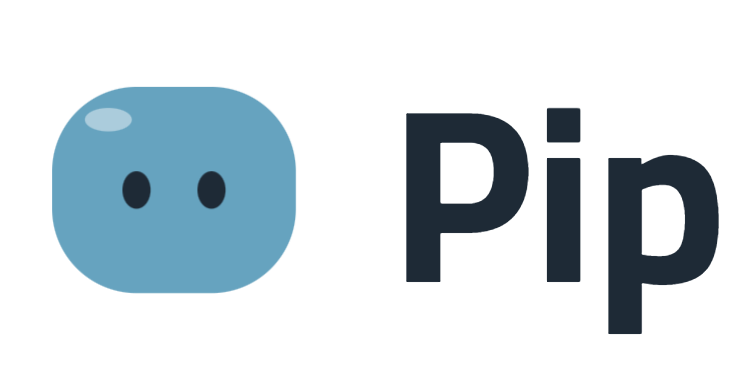
  </picture>
</h1>

<p align="center">
  <b>Plain steps from vague work messages. Built for autistic adults in their first year of work.</b><br>
  Reads only what you select. Removes names before any AI sees a word. Never sends anything for you.
</p>

<p align="center">
  
  
  
  
  
  
  
</p>

<p align="center">
  <video src="docs/images/pip-flow.mp4" poster="docs/images/pip-flow-poster.png" width="640" controls muted playsinline>
    <a href="docs/images/pip-flow.mp4">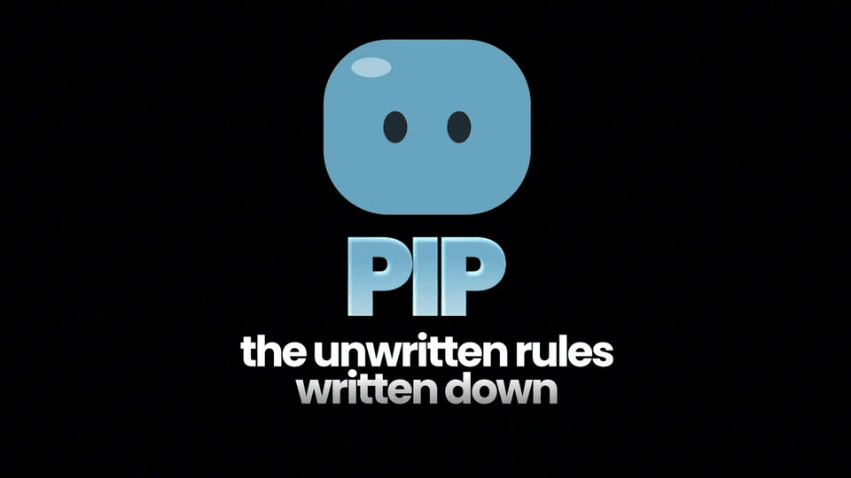</a>
  </video>


https://github.com/user-attachments/assets/2f209e01-11a4-48e6-aa80-7968b368215a


  <br>
  <sub><b>Pip's flow, 52 s, on a real Slack message.</b> The person selects it and presses the shortcut, reads Pip's bubble, opens <i>Break it into steps</i>, reads ahead with the bar, answers the halfway <i>How are you feeling?</i> and picks a calming option, then opens Pip's House to see their profile and what they taught Pip.</sub>
</p>

## Why Pip exists

For many autistic adults the hard part of a job is keeping it. Our interview with a Specialisterne coach (October 31, 2026) showed where it breaks:

- **Vague instructions.** "Send it when you get a chance" hides a date, a priority and an expectation.
- **Unwritten rules.** Meetings, lunch and tone come with norms nobody says out loud.
- **Changes.** A new manager, project or priorities destabilize a person who was doing well, and coaching support fades after the first months.
- **A profile that goes stale.** Specialisterne writes a professional profile for each person (how they learn, what stresses them, what they need). It is what an assistant could use every day, but today it sits in a document.

Pip is that assistant. It lives on top of the apps the person already uses, reads only what they select, and answers with small steps and, every time, **why**. It is **not** a focus timer, a to-do list or a chatbot: it never reads email or chat by itself, never sends anything for the person and never scolds. Research: [docs/research/](docs/research/). Reasoning: [docs/DECISIONS.md](docs/DECISIONS.md).

| Principle | In the product |
|---|---|
| Privacy is the product | Only text the person selects (or types or dictates and sends) leaves the computer, after names and contact details are removed |
| Every suggestion carries its why | The person keeps learning the rules instead of feeling they "express themselves badly" |
| Ask, don't guess | When a date or request is unclear, Pip drafts the question instead of inventing an answer |
| Calm by default | No red or yellow, no streaks, everything skippable; motion respects `prefers-reduced-motion` |
| The person decides | Pip suggests; the person accepts, edits, copies or ignores |

## What Pip does

Select text anywhere and press **Ctrl+Shift+Space** (Control+Shift+Space on a Mac). Click any picture to see it full size.

<table>
  <tr>
    <td width="33%" valign="top"><a href="docs/images/triage-bubble.png">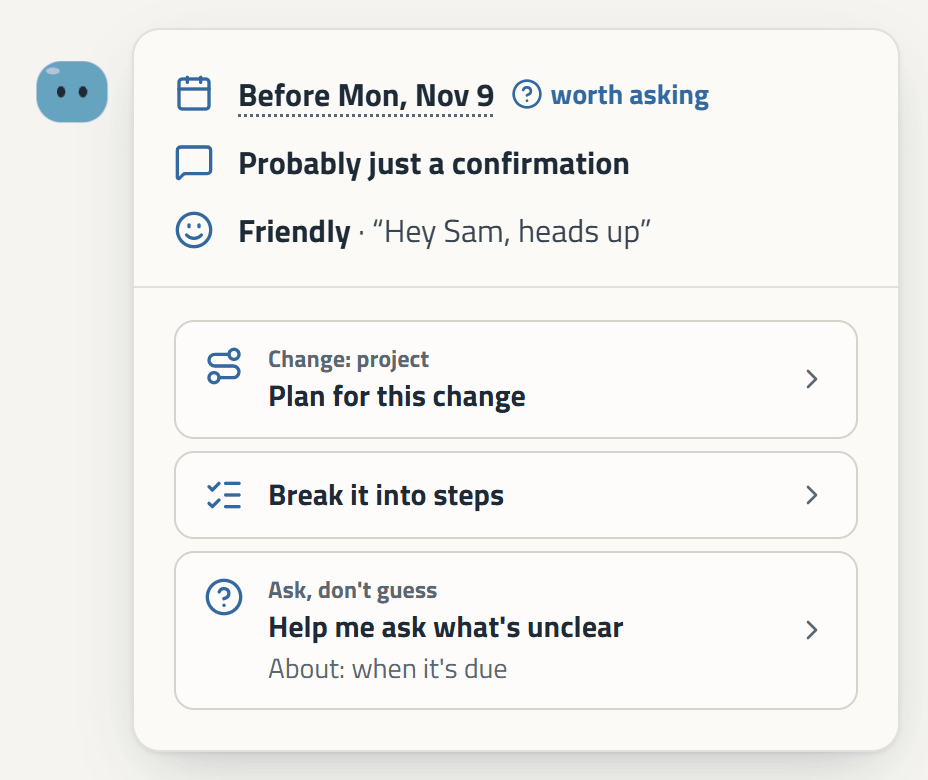</a><br><sub><b>Bubble.</b> Date, reply needed, tone and change. The buttons follow the findings.</sub></td>
    <td width="33%" valign="top"><a href="docs/images/steps-card.png">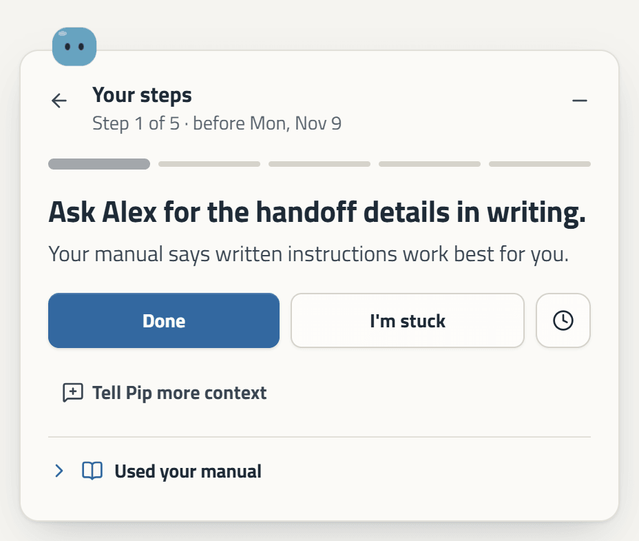</a><br><sub><b>Steps.</b> One at a time, each with its why and the part of the profile used. <i>Done</i> turns its segment blue.</sub></td>
    <td width="33%" valign="top"><a href="docs/images/steps-browse.png">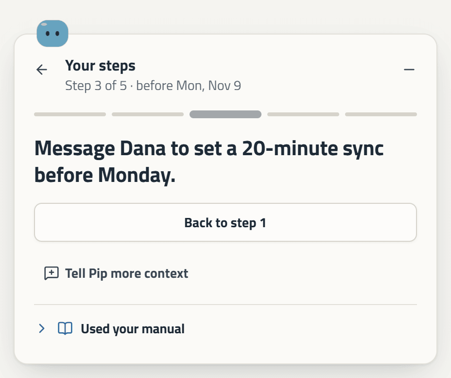</a><br><sub><b>Read ahead.</b> Click the bar to see any step without finishing anything.</sub></td>
  </tr>
  <tr>
    <td valign="top"><a href="docs/images/mood-check.png">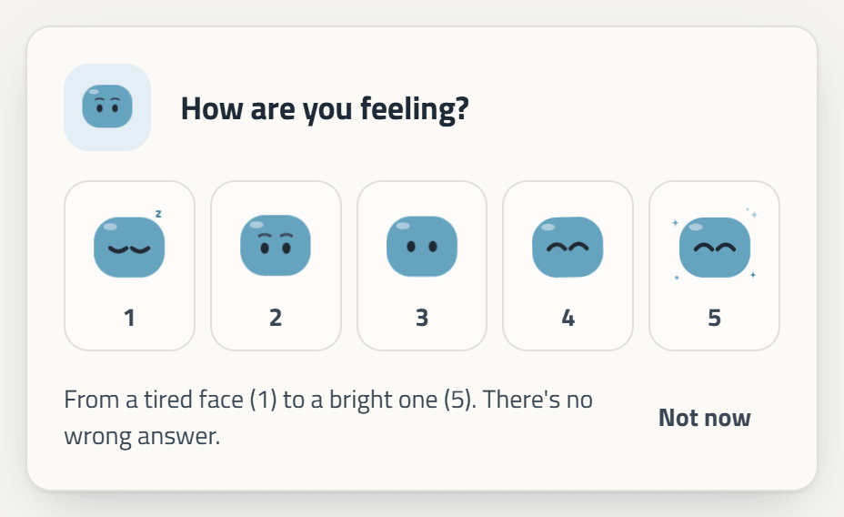</a><br><sub><b>Halfway check-in.</b> Asked once per list of steps, at the middle.</sub></td>
    <td valign="top"><a href="docs/images/mood-options.png">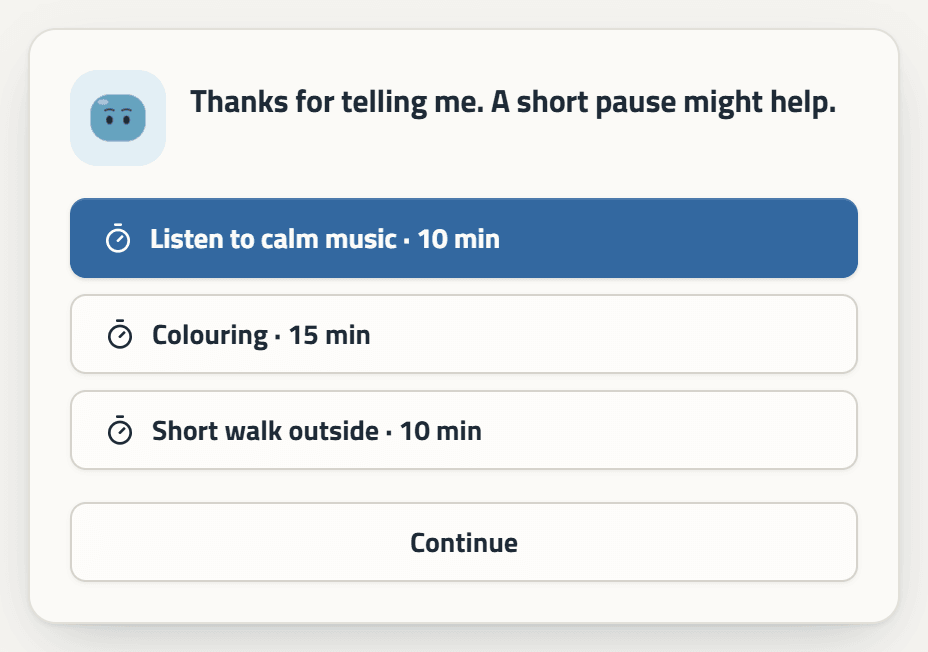</a><br><sub><b>Calming options.</b> From the profile. With low energy only the next 3 steps stay; higher answers just go on.</sub></td>
    <td valign="top"><a href="docs/images/ask-dont-guess.png">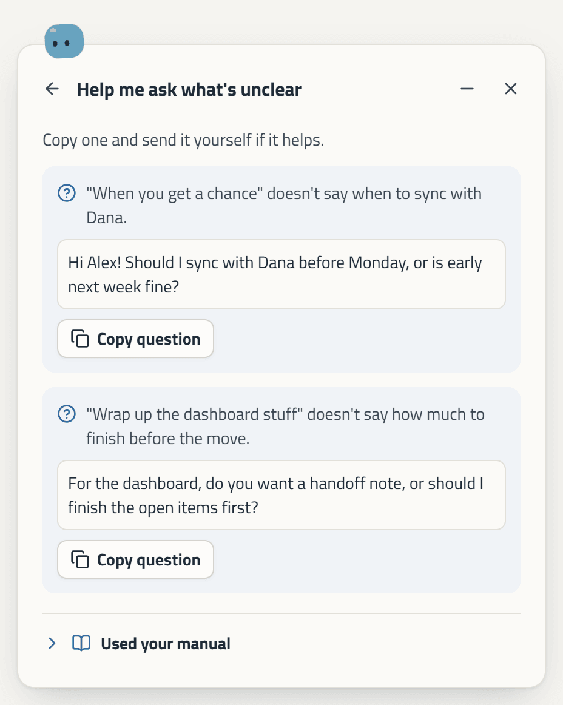</a><br><sub><b>Ask, don't guess.</b> Pip drafts the question; the person copies and sends it.</sub></td>
  </tr>
  <tr>
    <td valign="top"><a href="docs/images/change-plan.png">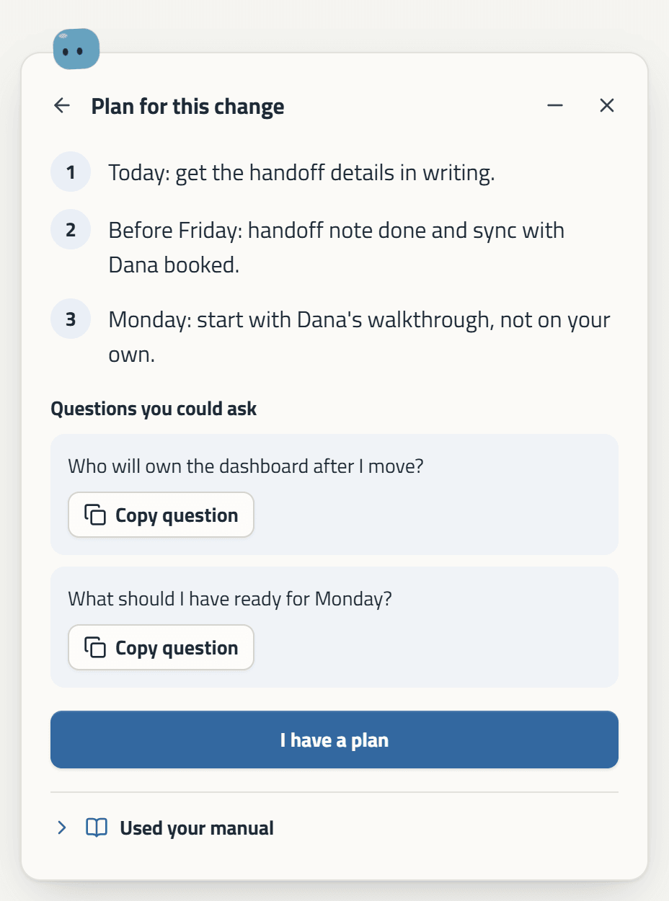</a><br><sub><b>Plan for a change.</b> Dated steps and questions worth asking.</sub></td>
    <td valign="top"><a href="docs/images/command-menu.png">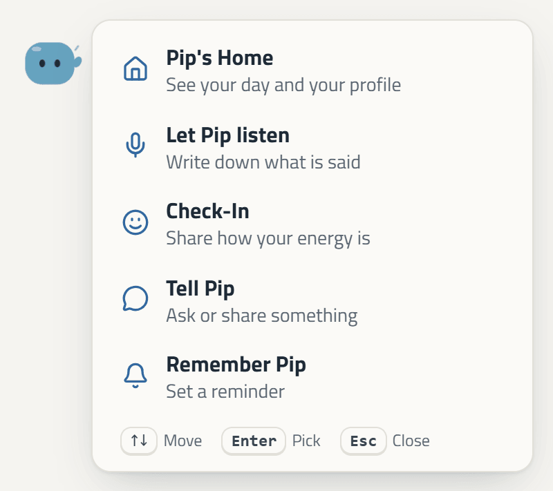</a><br><sub><b>Menu.</b> The same shortcut with nothing selected.</sub></td>
    <td valign="top"><a href="docs/images/tell-pip.png">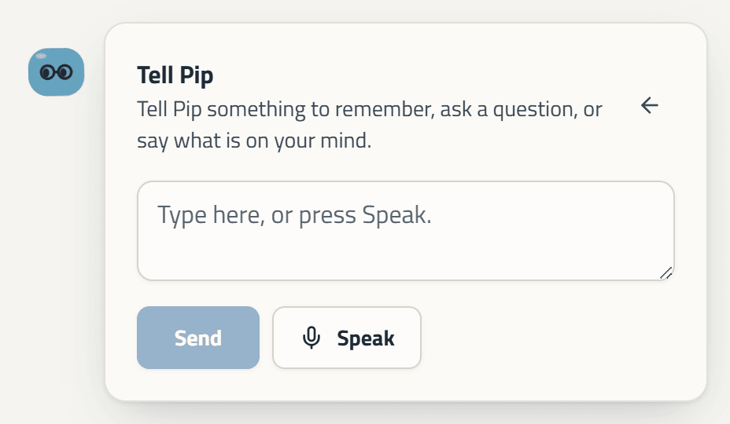</a><br><sub><b>Tell Pip.</b> Write or speak; nothing is sent until Send.</sub></td>
  </tr>
</table>

Around the steps: **I'm stuck** splits a step into smaller ones and asks for context Pip cannot know. **Tell Pip more context** lets the person add what Pip missed; the steps are redone and kept as a note ("What you taught Pip"). With 1-2 faces on the day's check-in, only 3 steps show and the rest "can wait".

### With nothing selected: Pip's menu

| Entry | What it does |
|---|---|
| Pip's Home | Opens Pip's House (below) |
| Let Pip listen | Records the microphone and/or computer audio (up to 10 minutes) and transcribes it **on this computer**; the person reviews the text first |
| Check-In | Energy faces (1-5, "spoons") at 9:00, 13:00 and 17:00 by default; editable, skippable, never insistent |
| Tell Pip | Write or speak and press Send; Pip answers with its why and offers to keep the words as a note |
| Remember Pip | A reminder at a chosen time (also the clock on a step), kept on this computer and shown under "Coming up". In the installed app Pip starts at login so reminders arrive; Settings can turn that off |

### Pip's House

A normal window for what does not fit an overlay: **Home** (today's energy, recent days, suggestions), **My profile** (every entry shows who wrote it and who can see it), **Achievements** (no streaks), **Summary** (tick-to-keep points for a coach, psychologist, therapist or manager, filtered by recipient in code), **Connections** (coming soon) and **Settings** (check-in times, pause, theme).

<table>
  <tr>
    <td width="33%" valign="top">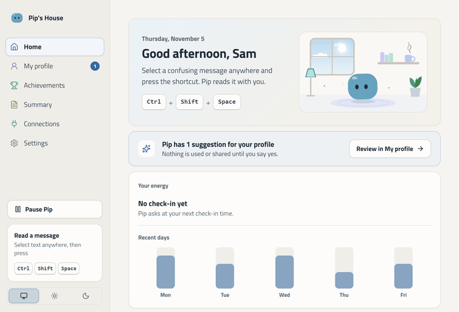<br><sub><b>The House.</b> Home to Settings.</sub></td>
    <td width="33%" valign="top"><a href="docs/images/house-profile.png">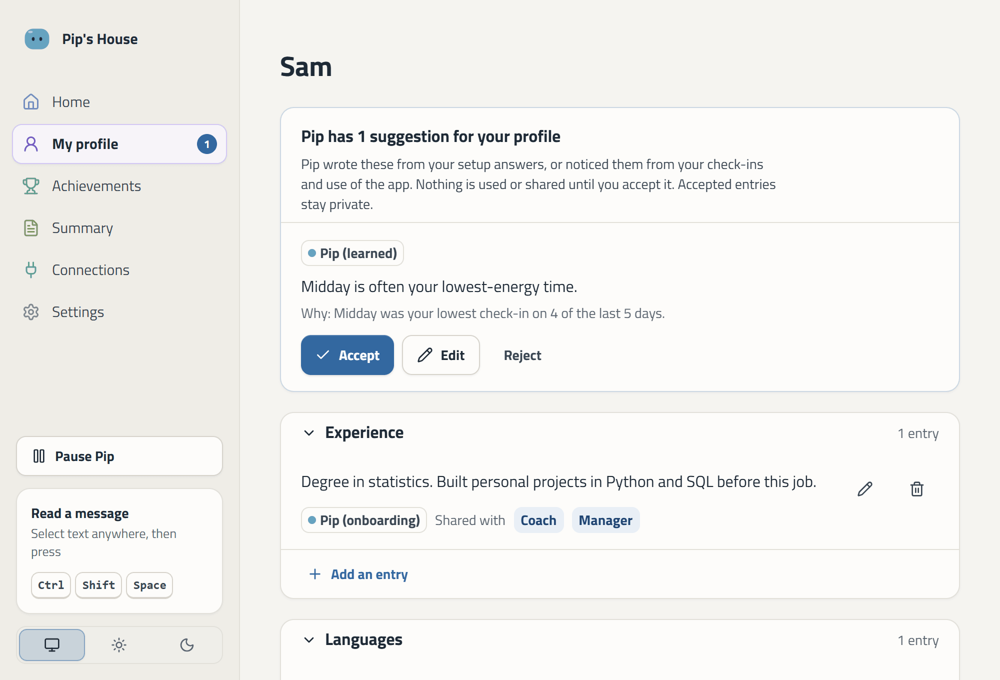</a><br><sub><b>My profile.</b> Pip's suggestions wait for a yes.</sub></td>
    <td width="33%" valign="top"><a href="docs/images/house-summary.png">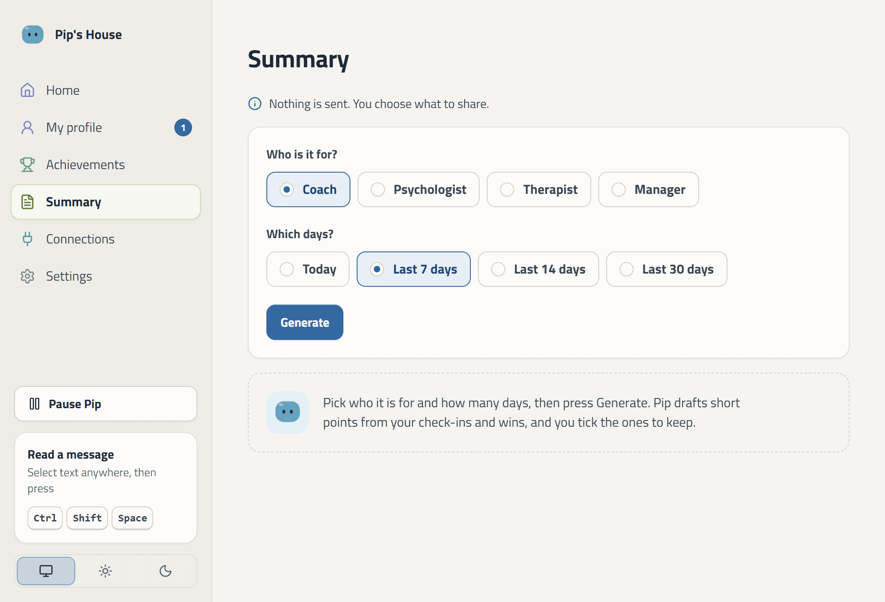</a><br><sub><b>Summary.</b> The person ticks what to keep. Nothing is sent.</sub></td>
  </tr>
</table>

### First run: onboarding

About 5 minutes, every step skippable: language and movement preferences, how Pip keeps messages private, who the person works with, six short questions about how they work best, and a practice run of the shortcut. The answers become **suggestions** for the profile; nothing is used or shared until the person accepts it.

<table>
  <tr>
    <td width="33%" valign="top"><a href="docs/images/onboarding-welcome.png">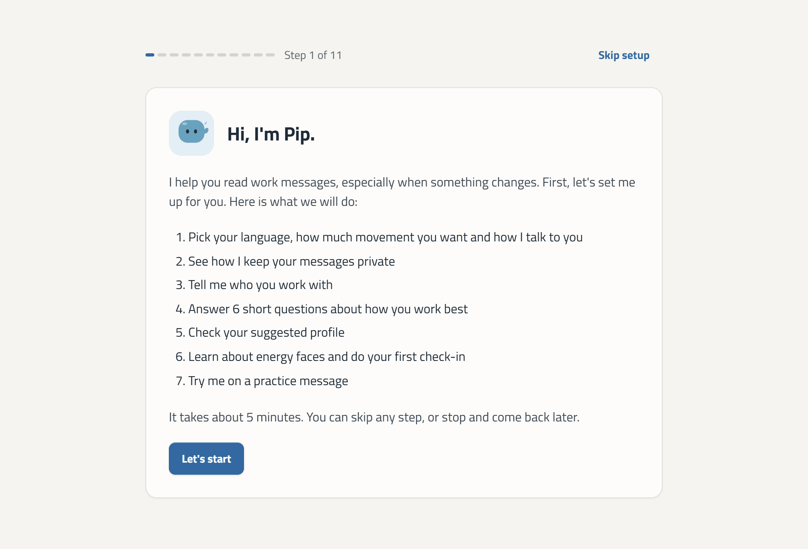</a><br><sub><b>Onboarding.</b> <code>PIP_DEMO=1</code> skips it.</sub></td>
    <td width="33%" valign="top"><a href="docs/images/check-in.png">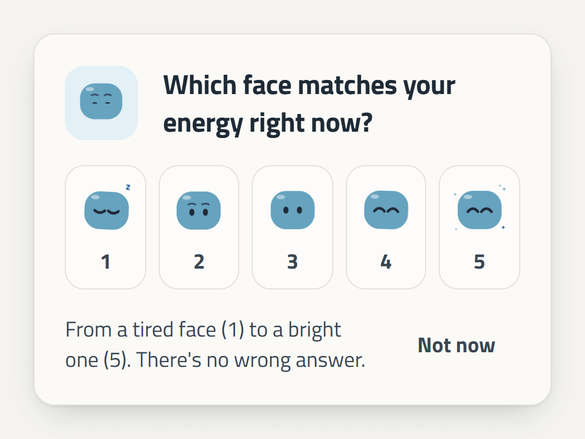</a><br><sub><b>Daily check-in.</b> Fewer steps when energy is low.</sub></td>
    <td width="33%" valign="top"><a href="docs/images/steps-card-dark.png">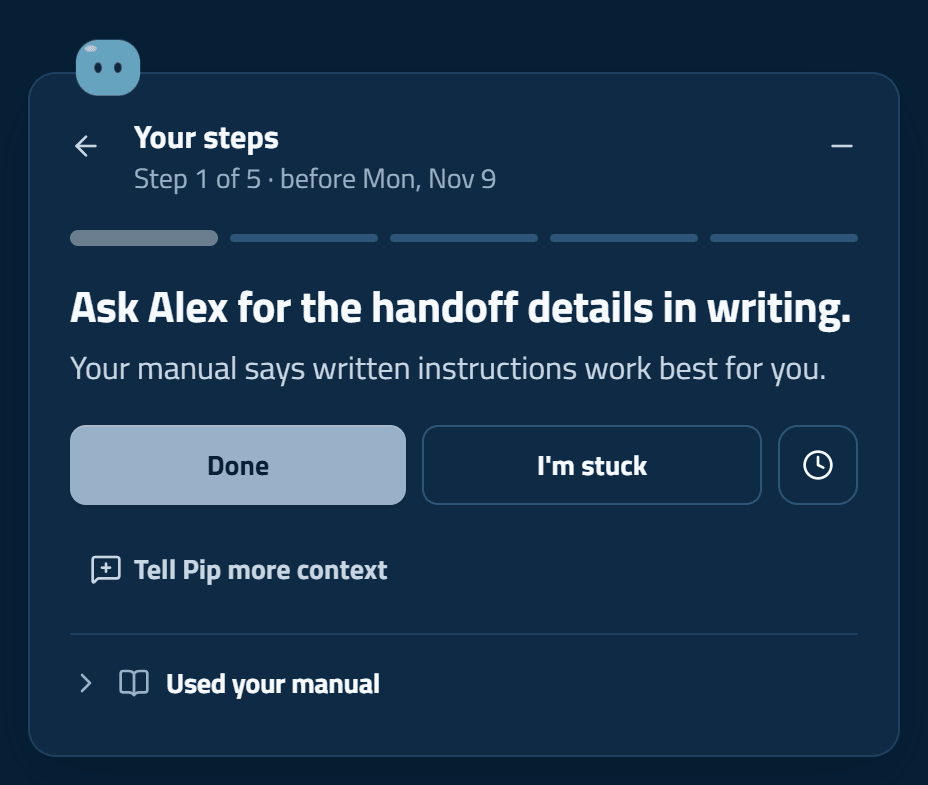</a><br><sub><b>Light, dark or system,</b> plus calmer motion in Settings.</sub></td>
  </tr>
</table>

## How to use it

1. **Start Pip** ([install](#install-and-run)). Go through onboarding or skip it; Pip then waits quietly and only opens by itself for check-ins and reminders.
2. **Select text** in any app and press **Ctrl+Shift+Space**.
3. **Press a button** in the bubble: *Break it into steps*, *Help me ask what's unclear* or *Plan for this change*.
4. **Work through the steps:** *Done*, read ahead with the bar, *I'm stuck*, *Tell Pip more context*, or the clock for a reminder. Answer the halfway question, or press *Not now*.
5. **With nothing selected** the shortcut opens the menu: listen, check in, tell Pip, set a reminder, open the House.

| Key | Action |
|---|---|
| Ctrl+Shift+Space (Control+Shift+Space on a Mac) | Read the selection, or open the menu when nothing is selected. While recording, it stops the recording. With typed text in an open card it does nothing, so the text is never lost |
| Esc | Close the open card or menu |
| Up / Down, Enter | Move and pick in the menu |

## How it works

### Architecture

Three layers talk only through a typed contract in `src/shared/`. API keys never live on the person's computer: they sit in a small Cloudflare Worker that forwards only Pip's own calls.

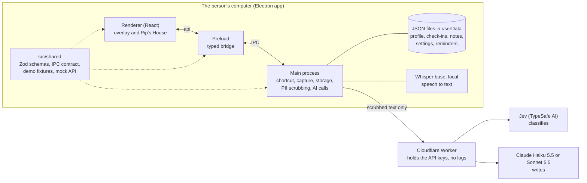

### Privacy pipeline

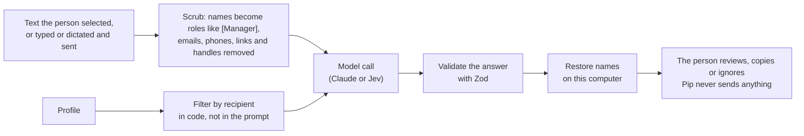

| Data | Where it goes |
|---|---|
| Selected text, or text typed or dictated after Send | Scrubbed, to Jev (triage) and, only when a button is pressed, to Claude |
| Onboarding answers | After a notice naming Claude (Anthropic); scrubbed; "Keep my words, don't send" is an option |
| Summary | Only the profile fields the chosen recipient may see reach Claude |
| Recordings | Transcribed on this computer; only reviewed text the person sends leaves |
| Profile, check-ins, notes, reminders, achievements | Local JSON files only |
| Clipboard history, screen, email, chat, audio | Never read or sent |

The scrubber covers accidental leaks (pasted text, invisible characters, accents, many alphabets), not crafted input, and only knows names in the profile or its aliases. Limits: [DECISIONS §5](docs/DECISIONS.md).

### AI roles

| Role | Model | When | Returns |
|---|---|---|---|
| Triage | **Jev** (TypeSafe AI classifier) | Shortcut pressed | Type, reply needed, urgency, deadline, tone with its quote, change or not, ambiguity, with calibrated probabilities |
| Writing | **Claude Haiku 5.5** (default) or **Sonnet 5.5** (`PIP_MODEL=sonnet`) | A button, I'm stuck, Tell Pip, onboarding, summary | JSON validated with Zod; every item carries its `why` |
| Transcription | **Whisper base** (ONNX, Transformers.js) | Let Pip listen | Text, computed on this computer |

Code, not the models, decides which buttons appear, the "unsure" thresholds, the three-step cut with low energy, the halfway check-in, what a recipient sees and what is scrubbed. Prompts forbid appealing to "common sense", because unwritten rules are what the person may not know. Why: [DECISIONS §4](docs/DECISIONS.md).

## Install and run

```bash
git clone https://github.com/pedroolib/pip-pal.git
cd pip-pal
npm install
npm run dev
```

`npm install` also downloads the Electron binary and rebuilds native dependencies, which takes a minute or two. The npm warning `Unknown project config "onnxruntime-node-install-cuda"` is expected and harmless: `.npmrc` stops the speech library from downloading unverified GPU binaries.

For voice capture (and before packaging), run once:

```bash
npm run fetch:whisper
```

It downloads the Whisper base model (about 80 MB, not in git), pinned to a specific revision and verified by SHA-256.

`npm run dev` starts the app with hot reload. Press the shortcut to try it; with a clean profile Pip starts with onboarding.

### Connect to the AI server: `PIP_ACCESS_TOKEN`

Pip's AI calls go through the team's server, which holds the API keys and only answers people with the team's access token.

1. Ask the team for the token. It is private and never committed.
2. Copy `.env.example` to `.env` (`cp .env.example .env`, or `Copy-Item .env.example .env` in PowerShell) and set the token:

   ```
   PIP_ACCESS_TOKEN=paste-the-token-here
   ```

3. Restart `npm run dev`. The app reads `.env` only when it starts.

**Without the token Pip still runs, on built-in example data:** the same sample bubble, steps and questions every time, and nothing leaves your computer. For the best demo that way, add `PIP_DEMO=1` to `.env` to start with the demo person "Sam" and skip onboarding.

The installed app does not read `.env`: set `PIP_ACCESS_TOKEN` as a system environment variable instead. Developers can use their own `ANTHROPIC_API_KEY` and `TYPESAFE_API_KEY` in `.env`; those calls go straight to the providers, not through the server.

## Project structure

```
pip-pal/
├── src/
│   ├── main/            Electron main process: windows, shortcut, capture, storage, reminders, voice
│   │   └── ai/          Claude and Jev calls, triage, expansions, PII-safe prompts, notes, summary
│   ├── preload/         Typed bridge exposed to the renderer as `api`
│   ├── renderer/        React UI
│   │   └── src/         overlay (triage, task, calm, mood, check-in, command), house, manual,
│   │                    onboarding, record, pip (the character), locales (en.json, es.json), assets
│   ├── shared/          The contract: Zod schemas, IPC API, fixtures, mock API, PII scrubber
│   └── proxy/           Cloudflare Worker that holds the API keys
├── scripts/             AI comparison scripts, speech model fetch, proxy token, README media
├── docs/                Plan, decisions, research, design references, evaluation workbook
├── resources/, build/   App icon, bundled speech model (not in git), installer settings
└── CLAUDE.md, GLOSSARY.md, .factory/   Working rules, vocabulary, AI-assisted workflow
```

| Module | What | Owner |
|---|---|---|
| `src/shared/` | The contract. **Changes only through a PR all three devs review** | All |
| `src/main/` (shell) | Windows, shortcut, capture, storage, IPC, packaging | A |
| `src/main/ai/`, `src/proxy/` | Claude and Jev calls, scrubbing, evaluation scripts, key proxy | B (Pedro) |
| `src/renderer/` | React UI, theme, character | C |
| `src/shared/fixtures/`, copy | Sam's demo profile and data, UI text, user testing | D |

## Documentation map

| Document | What it answers |
|---|---|
| [docs/PLAN.md](docs/PLAN.md) | What we build, by when and who owns what (Spanish) |
| [docs/DECISIONS.md](docs/DECISIONS.md) | Why each decision was made, alternatives rejected, technical notes per module (Spanish) |
| [GLOSSARY.md](GLOSSARY.md) | The words we use, and the ones we avoid |
| [docs/research/](docs/research/) | The interview, the concept, the post-interview plan and the challenge rubric, with the original PDFs |
| [docs/design/](docs/design/README.md) | Visual references, how the task card maps to shadcn and Tailwind, the Pip redesign brief |
| [CLAUDE.md](CLAUDE.md) | The working rules for contributors and AI coding tools |
| `.factory/` | Stack notes and lessons from our AI-agent workflow |

## Credits, external resources and AI assistance

### AI inside the product

**Jev** (TypeSafe AI), **Claude Haiku 5.5 / Sonnet 5.5** (Anthropic) and **Whisper base** (OpenAI model, ONNX conversion by Xenova on Hugging Face), as in [AI roles](#ai-roles). Calls go through our Cloudflare proxy, which sees scrubbed text in transit and does not log or store it. As we read its documentation, Jev's servers are in the United States and it does not train on inputs. Before onboarding sends anything, Pip tells the person that Claude (Anthropic) receives their scrubbed answers.

### AI used to build Pip

| Tool | How we used it |
|---|---|
| **Claude Code** (Anthropic) | Code, tests, debugging and docs from a teammate's instructions. Recent: the clickable step bar, the halfway mood check, the "I'm stuck" breakdown, and this README with its screenshots and diagrams. [CLAUDE.md](CLAUDE.md) holds the rules we give it |
| **Factory** (AI-agent orchestrator, Pedro's setup in `.factory/`) | Larger work packages (voice capture, PII scrubber hardening) with builder agents and separate reviewer agents for code, UI, UX and security, in rounds. Lessons: [.factory/LESSONS.md](.factory/LESSONS.md). The scrubber's test-only reference in `src/shared/__reference/` comes from that process |
| **shadcn MCP server** | Looking up and adding shadcn/ui components (`.mcp.json`) |
| **Claude and Jev inside Pip** | Runtime features, not development tools; see above |

How we keep it ours:

- Changes to `src/shared/`, `src/main/`, `src/preload/`, dependencies, `electron-builder.yml` and anything that sends data off the machine, including the PII scrubber, go to human review before merging (`.factory/stack.md`, [CLAUDE.md](CLAUDE.md)).
- Every change must pass `typecheck`, `lint`, tests and `build`; AI-written changes are tested like any other.
- Each module has a human owner (table above), and every non-obvious decision, rejected alternative and known limit is written in [docs/DECISIONS.md](docs/DECISIONS.md), so the team can explain and change what the tools wrote.
- AI output inside the product is validated against Zod schemas, shown as plain text and always accompanied by its reason.

### External code, models and assets

| Resource | Used for | License |
|---|---|---|
| [Electron](https://www.electronjs.org/) 44, [electron-vite](https://electron-vite.org/), [electron-builder](https://www.electron.build/), [Vite](https://vite.dev/) | Shell, build, packaging | MIT |
| [React](https://react.dev/) 19, [TypeScript](https://www.typescriptlang.org/) | UI, language | MIT, Apache-2.0 |
| [Tailwind CSS](https://tailwindcss.com/) 4, [tw-animate-css](https://github.com/Wombosvideo/tw-animate-css), [tailwind-merge](https://github.com/dcastil/tailwind-merge), [clsx](https://github.com/lukeed/clsx), [class-variance-authority](https://cva.style/) | Styling | MIT, Apache-2.0 |
| [shadcn/ui](https://ui.shadcn.com/) (copied into `src/renderer/src/components/ui/`), [Radix UI](https://www.radix-ui.com/) | Accessible components | MIT |
| [lucide-react](https://lucide.dev/) | Icons | ISC |
| [i18next](https://www.i18next.com/), react-i18next, [Zod](https://zod.dev/) | UI text, schemas | MIT |
| [@anthropic-ai/sdk](https://github.com/anthropics/anthropic-sdk-typescript), [@typesafe-ai/sdk](https://docs.typesafe.ai) | Claude and Jev clients | Apache-2.0, MIT |
| [Transformers.js](https://github.com/huggingface/transformers.js), [ONNX Runtime](https://onnxruntime.ai/), [Whisper base ONNX](https://huggingface.co/Xenova/whisper-base) | Local speech to text (model fetched by `fetch:whisper`, not in git) | Apache-2.0, MIT; see the model card (Whisper is MIT) |
| [sharp](https://sharp.pixelplumbing.com/), [Vitest](https://vitest.dev/), [ESLint](https://eslint.org/), [Prettier](https://prettier.io/) | README pictures, tests, style | Apache-2.0, MIT |
| [Cloudflare Workers](https://workers.cloudflare.com/) and Wrangler | Key proxy (Wrangler runs with `npx`) | Cloudflare terms |
| [Titillium Web](https://fonts.google.com/specimen/Titillium+Web) | Interface font, self-hosted with its license in `src/renderer/src/assets/fonts/` | SIL OFL 1.1 |

Exact versions: `package.json` and `package-lock.json`.

### References and research

- **Specialisterne** (Challenge Partner): the interview that shaped the product and the professional-profile practice "My profile" extends. Quotes in the research notes come from an automatic transcript and are marked for verification ([docs/research/](docs/research/)).
- **Navia** (previous Arizona AI Challenge winner): a benchmark for scope and clarity, not a source of code.
- **HeyClicky**: we took its onboarding flow (welcome, permissions with reasons, practising the gesture), not its design ([DECISIONS §13](docs/DECISIONS.md)).
- **Hermes**: its memory rules inspire the notes under "What you taught Pip"; we copied the rules, not files ([DECISIONS §15](docs/DECISIONS.md)).
- **Pip's look**: the character, the Harbor palette and the card layouts come from the team's design concept ([docs/design/](docs/design/README.md)).
- The structure of this README was informed by [NVIDIA/auto-ontology](https://github.com/NVIDIA/auto-ontology); the text is our own.
