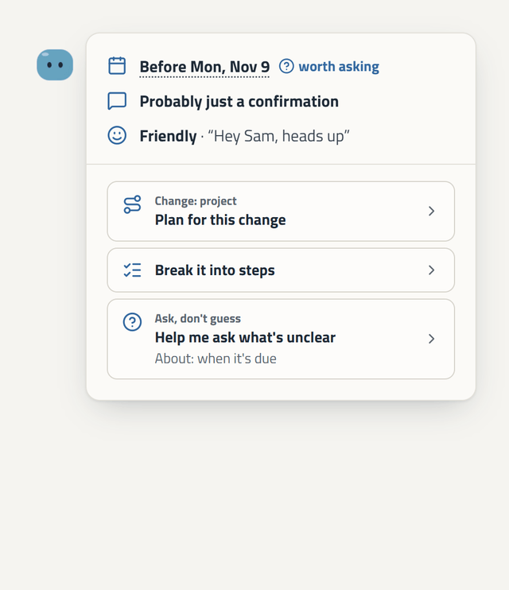
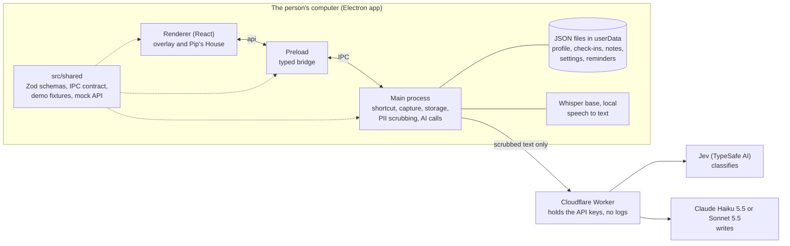
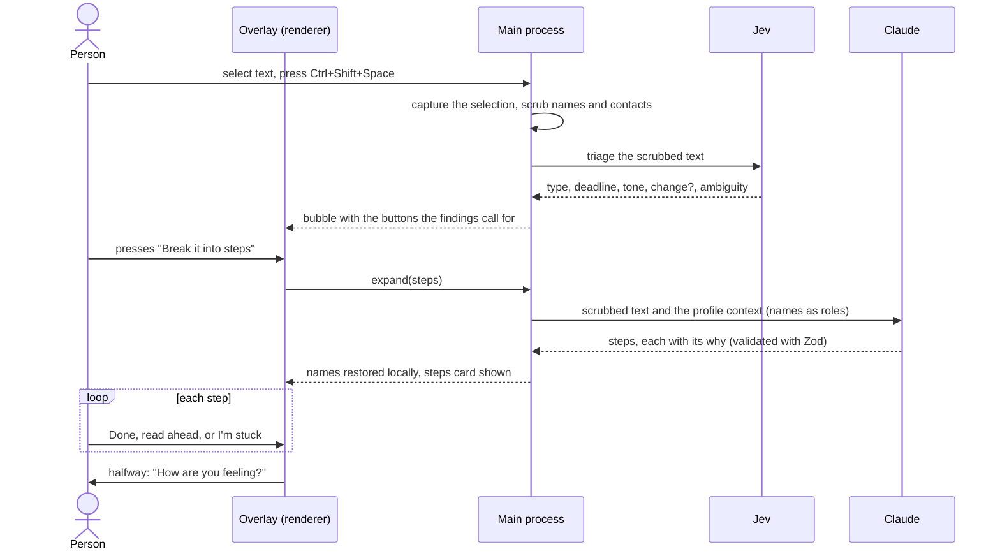
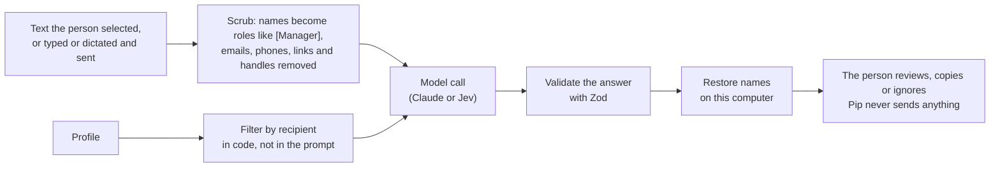

<h1 align="center">
  <picture>
    <source media="(prefers-color-scheme: dark)" srcset="docs/images/banner-dark.png">
    
  </picture>
</h1>

<p align="center">
  <b>Plain steps from vague work messages. Built for autistic adults in their first year of work.</b><br>
  Reads only what you select. Removes names before any AI sees a word. Never sends anything for you.
</p>

<p align="center">
  
  
  
  
  
  
  
</p>

<p align="center">
  <a href="#why-pip">Why</a> ·
  <a href="#what-pip-does">Features</a> ·
  <a href="#how-it-works">How it works</a> ·
  <a href="#getting-started">Get started</a> ·
  <a href="#credits-external-resources-and-ai-assistance">Credits and AI</a>
</p>

<p align="center">
  
  <br>
  <sub><b>Pip's flow.</b> Select text and press the shortcut, read Pip's bubble, open <i>Break it into steps</i>, read ahead with the bar, finish steps (each turns blue), answer the halfway <i>How are you feeling?</i> and, if energy is low, pick a calming option before the rest.</sub>
</p>

> Prototype for the NA AI Challenge 2026 (Arizona State University), with Specialisterne as Challenge Partner. Without a team access token Pip answers from built-in demo data, so anyone can run it. Open items: [Known limitations](#known-limitations).

## Why Pip

For many autistic adults the hard part of a job is keeping it. Our interview with a Specialisterne coach (October 31, 2026) found four breaking points, and Pip answers each:

| Where work breaks | What Pip does |
|---|---|
| Vague instructions ("when you get a chance") | Turns them into small steps, each with its *why*; drafts the question when a date or request is unclear |
| Unwritten rules | Gives the reason behind every step and suggestion |
| Changes (new manager, project, priorities) | A plan for the change, questions worth asking, calming options |
| A profile that goes stale | Uses the person's professional profile every day and shows which part it used |

Pip is **not** a focus timer, a to-do list or a chatbot. It never reads email or chat by itself, never sends anything for the person and never scolds. Principles: privacy is the product, every suggestion carries its why, ask don't guess, calm by default (no red or yellow, no streaks, motion respects `prefers-reduced-motion`), the person decides. Research: [docs/research/](docs/research/). Reasoning: [docs/DECISIONS.md](docs/DECISIONS.md).

## What Pip does

Select text anywhere and press **Ctrl+Shift+Space** (Control+Shift+Space on a Mac). Click any picture to see it full size.

<table>
  <tr>
    <td width="33%" valign="top"><a href="docs/images/triage-bubble.png"></a><br><sub><b>Bubble.</b> Date, reply needed, tone and change. The buttons follow the findings.</sub></td>
    <td width="33%" valign="top"><a href="docs/images/steps-card.png"></a><br><sub><b>Steps.</b> One at a time, each with its why. <i>Done</i> turns its segment blue.</sub></td>
    <td width="33%" valign="top"><a href="docs/images/steps-browse.png"></a><br><sub><b>Read ahead.</b> Click the bar to see any step without finishing anything.</sub></td>
  </tr>
  <tr>
    <td valign="top"><a href="docs/images/mood-check.png"></a><br><sub><b>Halfway check-in.</b> Asked once per list of steps, at the middle.</sub></td>
    <td valign="top"><a href="docs/images/mood-options.png"></a><br><sub><b>Calming options.</b> From the profile. With low energy only the next 3 steps stay.</sub></td>
    <td valign="top"><a href="docs/images/ask-dont-guess.png"></a><br><sub><b>Ask, don't guess.</b> Pip drafts the question; the person copies and sends it.</sub></td>
  </tr>
  <tr>
    <td valign="top"><a href="docs/images/change-plan.png"></a><br><sub><b>Plan for a change.</b> Dated steps and questions worth asking.</sub></td>
    <td valign="top"><a href="docs/images/command-menu.png"></a><br><sub><b>Menu.</b> The same shortcut with nothing selected.</sub></td>
    <td valign="top"><a href="docs/images/tell-pip.png"></a><br><sub><b>Tell Pip.</b> Write or speak; nothing is sent until Send.</sub></td>
  </tr>
  <tr>
    <td valign="top"><a href="docs/images/check-in.png"></a><br><sub><b>Check-in.</b> Energy faces at 9:00, 13:00 and 17:00 (editable, skippable).</sub></td>
    <td valign="top"><a href="docs/images/onboarding-welcome.png"></a><br><sub><b>Onboarding.</b> About 5 minutes, skippable; answers become suggestions.</sub></td>
    <td valign="top"><a href="docs/images/steps-card-dark.png"></a><br><sub><b>Light, dark or system,</b> plus a calmer-motion setting.</sub></td>
  </tr>
</table>

| Also | What it does |
|---|---|
| **I'm stuck** | Splits the current step into smaller ones; asks for context Pip cannot know |
| **Tell Pip more context** | The person adds what Pip missed; steps are redone and kept as a note ("What you taught Pip") |
| **Let Pip listen** | Records microphone and/or computer audio (up to 10 min), transcribed **on this computer**; the person reviews the text first |
| **Reminders** | The clock on a step, or *Remember Pip*; stored locally, shown under "Coming up"; Pip starts at login in the installed app (Settings can turn it off) |
| **Low energy** | With 1-2 faces on the day's check-in only 3 steps show; the rest "can wait" |

**Pip's House** is a normal window for what does not fit an overlay: Home, My profile (every entry shows who wrote it and who can see it), Achievements (no streaks), Summary (tick-to-keep points for a coach, psychologist, therapist or manager, filtered by recipient in code), Connections (coming soon) and Settings (check-in times, pause, theme).

<table>
  <tr>
    <td width="33%" valign="top"><br><sub><b>The House.</b> Home to Settings.</sub></td>
    <td width="33%" valign="top"><a href="docs/images/house-profile.png"></a><br><sub><b>My profile.</b> Pip's suggestions wait for a yes.</sub></td>
    <td width="33%" valign="top"><a href="docs/images/house-summary.png"></a><br><sub><b>Summary.</b> The person ticks what to keep.</sub></td>
  </tr>
</table>

## How to use it

1. **Start Pip** ([install](#getting-started)). Go through onboarding or skip it. Pip then waits; it only opens by itself for check-ins and reminders.
2. **Select text** in any app and press **Ctrl+Shift+Space**.
3. **Press a button** in the bubble: *Break it into steps*, *Help me ask what's unclear* or *Plan for this change*.
4. **Work through the steps:** *Done*, read ahead with the bar, *I'm stuck*, *Tell Pip more context*, or the clock for a reminder.
5. **With nothing selected** the shortcut opens the menu: listen, check in, tell Pip, set a reminder, open the House.

`Esc` closes the open card or menu. While recording, the shortcut stops the recording. With typed text in an open card it does nothing, so the text is never lost.

## How it works

Three layers talk only through a typed contract in `src/shared/`. API keys never reach the person's computer: they live in a small Cloudflare Worker that forwards only Pip's own calls.



In a plain browser (no preload) the renderer uses `src/shared/mock-api.ts` and the demo fixtures, so the UI can be built and reviewed without Electron or keys.

Jev classifies instantly so the bubble appears fast; Claude is called once, only when a button is pressed, with no retries.



### Privacy



| Data | Where it goes |
|---|---|
| Selected text, typed or dictated text after Send | Scrubbed, to Jev (triage) and, only when a button is pressed, to Claude |
| Onboarding answers | After a notice naming Claude (Anthropic); scrubbed; "Keep my words, don't send" is an option |
| Summary | Only the profile fields the chosen recipient may see reach Claude |
| Recordings | Transcribed on this computer; only reviewed text the person sends leaves |
| Profile, check-ins, notes, reminders, achievements | Local JSON files only |
| Clipboard history, screen, email, chat, audio | Never read or sent |

The scrubber covers accidental leaks (pasted text, invisible characters, accents, many alphabets), not crafted input, and only knows names in the profile or its aliases. Limits: [DECISIONS §5](docs/DECISIONS.md).

### AI roles

| Role | Model | When | Returns |
|---|---|---|---|
| Triage | **Jev** (TypeSafe AI classifier) | Shortcut pressed | Type, reply needed, urgency, deadline, tone with its quote, change or not, ambiguity, with calibrated probabilities |
| Writing | **Claude Haiku 5.5** (default) or **Sonnet 5.5** (`PIP_MODEL=sonnet`) | A button, I'm stuck, Tell Pip, onboarding, summary | JSON validated with Zod; every item carries its `why` |
| Transcription | **Whisper base** (ONNX, Transformers.js) | Let Pip listen | Text, computed on this computer |

Code, not models, decides which buttons appear, the "unsure" thresholds, the three-step cut, the halfway check-in, what a recipient sees and what is scrubbed. Prompts forbid appealing to "common sense", because unwritten rules are what the person may not know. Why: [DECISIONS §4](docs/DECISIONS.md).

## Getting started

| Need | Detail |
|---|---|
| OS | Windows 10/11, macOS (Apple Silicon is the packaged target) or Linux |
| Node.js and npm | **Node 22.12+** (Electron 44 and Vitest 5 require it); developed with Node 24 and npm 11 |
| Internet | `npm install` downloads the Electron binary; the speech model is optional |
| Disk | About 1.1 GB for `node_modules`, plus about 80 MB for the speech model |
| API access | **Not needed.** Without it Pip answers from demo data |

```bash
git clone https://github.com/pedroolib/pip-pal.git
cd pip-pal
npm install
npm run dev
```

`npm install` also fetches Electron and rebuilds native modules (a minute or two). The warning `Unknown project config "onnxruntime-node-install-cuda"` is expected: `.npmrc` stops the speech library from downloading unverified GPU binaries. For voice capture, and before packaging, run `npm run fetch:whisper` once (about 80 MB, pinned revision, verified by SHA-256).

**Configuration.** Copy `.env.example` to `.env` (gitignored); every variable is optional.

| Variable | Effect |
|---|---|
| *(none)* | **Demo mode:** Pip answers from `src/shared/fixtures/`; nothing leaves the computer |
| `PIP_ACCESS_TOKEN` | The team's private token for the hosted proxy (`src/proxy/`), which holds the API keys. Ask the team; never committed |
| `ANTHROPIC_API_KEY`, `TYPESAFE_API_KEY` | Your own keys, for developers: calls go straight to the providers |
| `PIP_MODEL` | `haiku` (default) or `sonnet` |
| `PIP_DEMO` | `1` starts with the demo person "Sam" and skips onboarding (used on the demo Mac) |

The installed app reads the system environment, not `.env`. Keys and the token live only in the main process.

**Platform notes**

| Platform | What to know |
|---|---|
| Windows | Pip presses Ctrl+C through PowerShell to read the selection; with a terminal in front it opens the menu instead |
| macOS | Asks once for **Accessibility** (and Microphone, System Audio Recording for voice). The packaged app is unsigned: right-click, then Open |
| Linux (Hyprland) | Bind the key to the app: `bind = CTRL SHIFT, SPACE, exec, pip-pal --capture`; install `wl-clipboard` |

**Commands**

| Command | What it does |
|---|---|
| `npm run dev` / `npm start` | Run with hot reload / preview the production build (`npm run build` first) |
| `npm run typecheck`, `lint`, `test`, `build` | The gates every change passes |
| `npm run build:win`, `build:mac`, `build:linux`, `build:unpack` | Package into `dist/` (run `fetch:whisper` first) |
| `npm run ai:lite`, `ai:compare`, `ai:notes` | Compare models on fictional messages (real, paid calls; `ai:compare --dry` uses fake clients) |
| `npx electron scripts/readme-media.mjs` | Regenerate the pictures in `docs/images/` (after `npm run build`) |
| `node scripts/new-proxy-token.mjs` | Create or replace the proxy token (maintainers) |

To work on the UI without Electron, open `http://localhost:3000` while `npm run dev` runs. Flags: `?spoons=1..5`, `?triage=loading|error`, `?menu=1`, `?tell=1`, `?remind=1`, `?record=1`, `?due=1`; the House is at `#/home` (`#/home/profile`, `/summary`, ...).

**Troubleshooting**

| Symptom | Fix |
|---|---|
| `tsc` or `electron-vite` "is not recognized" | Run `npm install` |
| Pip always shows the same example text | Demo mode (no token or key set); expected |
| `Port 3000 is already in use` | The renderer port is pinned to 3000; stop the other server |
| Shortcut does nothing on macOS | Grant Accessibility to Pip, or to the terminal running `npm run dev` |
| Voice cannot hear or transcribe | Run `npm run fetch:whisper` and allow the microphone |
| Many `Delete ␍` lint warnings on Windows | CRLF line endings: warnings, not errors (`git config core.autocrlf input` or `npm run format`) |

## Project structure

```
src/
├── main/       Electron main: windows, shortcut, capture, storage, reminders, voice
│   └── ai/     Claude and Jev calls, triage, expansions, prompts, notes, summary
├── preload/    Typed bridge exposed to the renderer as `api`
├── renderer/   React UI: overlay (bubble, task, mood, check-in, command), House, onboarding, Pip
├── shared/     The contract: Zod schemas, IPC API, fixtures, mock API, PII scrubber
└── proxy/      Cloudflare Worker that holds the API keys
scripts/        AI comparison, speech model fetch, proxy token, README pictures
docs/           Plan, decisions, research, design, cost and evaluation sheets
```

| Module | Owner |
|---|---|
| `src/shared/` (changes need a PR all three devs review) | All |
| `src/main/` shell: windows, shortcut, capture, storage, IPC, packaging | A |
| `src/main/ai/`, `src/proxy/`: AI calls, scrubbing, evaluation, key proxy | B (Pedro) |
| `src/renderer/`: UI, theme, character | C |
| Fixtures, UI copy, user testing | D |

## Testing and evaluation

- `npm test` runs about 1,700 Vitest tests in 43 files (scrubber, schemas, stores, scheduling, AI wrappers with fake clients, UI logic, proxy). `typecheck`, `lint` and `build` pass.
- Five scrubber performance tests in `src/shared/profile.test.ts` (hostile 8,000-character inputs, 1 s budget) exceed their budget on our Windows machine: a known limit on adversarial text ([DECISIONS §5](docs/DECISIONS.md)).
- **AI evaluation:** scripts over 9 fictional messages (`scripts/compare-messages.json`) compare Haiku with Sonnet and Jev with Claude. A labelled set of 30 messages, with and without the profile, is planned ([PLAN](docs/PLAN.md)); its counts will be published here.
- **Users:** the Specialisterne interview is in [docs/research/](docs/research/); sessions with people from their network are being scheduled.
- **Business:** [Pip_Evaluacion_Proyecto.xlsx](docs/Pip_Evaluacion_Proyecto.xlsx) (Spanish) models plans and prices, monthly cost per user, and base, pessimistic and optimistic scenarios; every figure is computed from its `Datos` sheet.

| Docs | What it answers |
|---|---|
| [PLAN.md](docs/PLAN.md), [DECISIONS.md](docs/DECISIONS.md) | What we build and who owns it; why, alternatives rejected, technical notes (Spanish) |
| [GLOSSARY.md](GLOSSARY.md) | The words we use and avoid |
| [docs/research/](docs/research/) | Interview, concept, challenge rubric (with original PDFs) |
| [docs/design/](docs/design/README.md) | Visual references and how the cards map to shadcn and Tailwind |
| [CLAUDE.md](CLAUDE.md), `.factory/` | Working rules and our AI-assisted workflow |

## Credits, external resources and AI assistance

### AI inside the product

**Jev** (TypeSafe AI), **Claude Haiku 5.5 / Sonnet 5.5** (Anthropic) and **Whisper base** (OpenAI model, ONNX conversion by Xenova), as in [AI roles](#ai-roles). Calls go through our Cloudflare proxy, which sees scrubbed text in transit and does not log or store it. As we read its documentation, Jev's servers are in the United States and it does not train on inputs. Before onboarding sends anything, Pip tells the person that Claude (Anthropic) receives their scrubbed answers.

### AI used to build Pip

We used AI coding tools, and say so here because git history does not show it: by team policy ([DECISIONS §11](docs/DECISIONS.md)) commits and PRs carry the name of the teammate who pushes them, not an AI co-author line.

| Tool | How we used it |
|---|---|
| **Claude Code** (Anthropic) | Code, tests, debugging and docs from a teammate's instructions. Recent: the clickable step bar, the halfway check-in, "I'm stuck", and this README with its pictures and diagrams. [CLAUDE.md](CLAUDE.md) holds its rules |
| **Factory** (AI-agent orchestrator, `.factory/`) | Larger work packages (voice capture, PII scrubber hardening) with builder agents and separate reviewer agents for code, UI, UX and security, in rounds. Lessons: [.factory/LESSONS.md](.factory/LESSONS.md). The scrubber's test-only reference in `src/shared/__reference/` comes from it |
| **shadcn MCP server** | Looking up and adding shadcn/ui components (`.mcp.json`) |

How we keep it ours: `src/shared/`, `src/main/`, `src/preload/`, dependencies, `electron-builder.yml` and anything that sends data off the machine go to human review before merging; every change passes `typecheck`, `lint`, tests and `build`; each module has a human owner; every non-obvious decision and known limit is written in [DECISIONS](docs/DECISIONS.md) so the team can explain and change what the tools wrote; model output is validated with Zod, shown as plain text and always carries its reason.

### External code, models and assets

| Resource | Used for | License |
|---|---|---|
| [Electron](https://www.electronjs.org/) 44, [electron-vite](https://electron-vite.org/), [electron-builder](https://www.electron.build/), [Vite](https://vite.dev/) | Shell, build, packaging | MIT |
| [React](https://react.dev/) 19, [TypeScript](https://www.typescriptlang.org/) | UI, language | MIT, Apache-2.0 |
| [Tailwind CSS](https://tailwindcss.com/) 4, tw-animate-css, tailwind-merge, clsx, [class-variance-authority](https://cva.style/) | Styling | MIT, Apache-2.0 |
| [shadcn/ui](https://ui.shadcn.com/) (copied into `src/renderer/src/components/ui/`), [Radix UI](https://www.radix-ui.com/) | Accessible components | MIT |
| [lucide-react](https://lucide.dev/) | Icons | ISC |
| [i18next](https://www.i18next.com/), react-i18next, [Zod](https://zod.dev/) | UI text, schemas | MIT |
| [@anthropic-ai/sdk](https://github.com/anthropics/anthropic-sdk-typescript), [@typesafe-ai/sdk](https://docs.typesafe.ai) | Claude and Jev clients | Apache-2.0, MIT |
| [Transformers.js](https://github.com/huggingface/transformers.js), [ONNX Runtime](https://onnxruntime.ai/), [Whisper base ONNX](https://huggingface.co/Xenova/whisper-base) | Local speech to text (model fetched by `fetch:whisper`, not in git) | Apache-2.0, MIT; see the model card (Whisper is MIT) |
| [sharp](https://sharp.pixelplumbing.com/), [Vitest](https://vitest.dev/), [ESLint](https://eslint.org/), [Prettier](https://prettier.io/) | README pictures, tests, style | Apache-2.0, MIT |
| [Cloudflare Workers](https://workers.cloudflare.com/) and Wrangler | Key proxy (Wrangler runs with `npx`) | Cloudflare terms |
| [Titillium Web](https://fonts.google.com/specimen/Titillium+Web) | Interface font, self-hosted with its license in `src/renderer/src/assets/fonts/` | SIL OFL 1.1 |

Versions: `package.json` and `package-lock.json`.

**References.** *Specialisterne* (Challenge Partner): the interview that shaped the product and the professional-profile practice "My profile" extends; research quotes come from an automatic transcript and are marked for verification. *Navia* (previous Arizona AI Challenge winner): a benchmark for scope, not code. *HeyClicky*: we took its onboarding flow, not its design ([DECISIONS §13](docs/DECISIONS.md)). *Hermes*: we copied its memory rules, not files ([§15](docs/DECISIONS.md)). Pip's look comes from the team's design concept ([docs/design/](docs/design/README.md)). This README's structure was informed by [NVIDIA/auto-ontology](https://github.com/NVIDIA/auto-ontology); the text is ours.

## Contributing

Built by a team of four (`git shortlog` has the history). One branch per feature, PR to `main`; `src/shared/` changes need all three devs' review. UI text goes in `src/renderer/src/locales/en.json` (Spanish in `es.json`). The renderer talks to main only through `api` from `@renderer/api`. Harbor theme only, via the CSS variables in `assets/main.css`; no red or yellow. shadcn for interactive pieces, plain Tailwind for visual ones. Every AI suggestion carries its `why`. Clickable overlay pieces outside a `Card` carry `data-overlay-hit`.

## Known limitations

- Voice capture and the packaged app still need testing on a real Mac (and computer audio on Windows); the Mac build is unsigned.
- No cache fallback or replay key for the live demo: a slow or failed call shows a plain error.
- The profile is stored unencrypted; encrypting it with the OS keychain is planned before real users enter their data.
- One proxy token is shared by the team; per-person licenses come after the Launchpad.
- Not built yet: PDF export of the summary, the "unspoken expectations" card, the Connections tab. About 170 strings are untranslated in Spanish.
- The scrubber targets accidental leaks and only knows names in the profile ([DECISIONS §5](docs/DECISIONS.md)).

Full list: [docs/PLAN.md §8](docs/PLAN.md).

## License

No open-source license has been chosen yet, so all rights are reserved by the authors until one is added. Third-party components keep their own licenses (see [External code, models and assets](#external-code-models-and-assets)).
